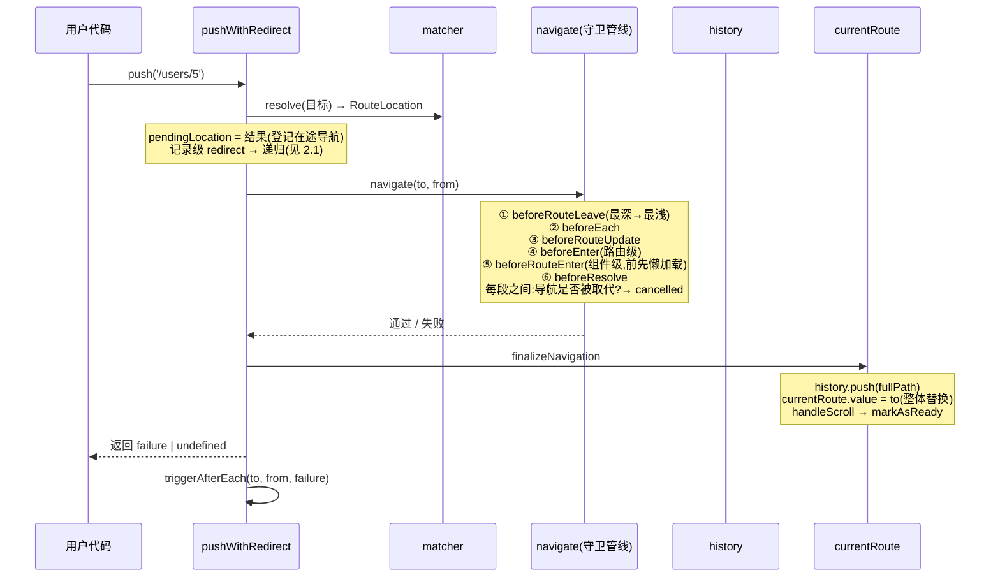

# 03 · 一次 push 的完整生命周期

> 对应官方:`packages/router/src/router.ts`(createRouter 的 pushWithRedirect / navigate / finalizeNavigation)
> 本仓库实现:`src/router.ts`

这是整个路由器的核心。看完这一章,「vue-router 到底做了什么」就通了。

## 1. 时序总览



## 2. pushWithRedirect:入口的三道闸

[`pushWithRedirect`](../src/router.ts) 是 `push`/`replace` 的共同实现,开头就做了三件事:

### 2.1 消费「记录级 redirect」

```ts
{ path: '/redirect-me', redirect: '/users' }
```

resolve 得到的位置里,`matched` 最后一条记录可能带 `redirect` 字段。入口会:

```
handleRedirectRecord(targetLocation)
  ├─ redirect 是函数 → 调用它拿新目标
  ├─ redirect 是字符串 → 转成 { path } 对象
  └─ 合并原目标的 query/hash/params
      → 带着 redirectedFrom 链重新 pushWithRedirect(递归)
```

递归是「链式重定向」的天然实现;mini 对**守卫内重定向**加了 10 次上限防死循环(官方 30 次,见 04 章)。

### 2.2 duplicated 判定

目标与当前位置**完全相同**(matched 链非空且等长、最后一条记录同一、params/query/hash 全等)→ 直接返回 `duplicated` 失败,不再跑管线。

注意判定算法的一个细节([`isSameRouteLocation`](../src/router.ts)):**matched 为空时永远返回 false**——这样「首次导航到 `/`」不会被 START_LOCATION 误判成重复导航(这是我们对拍时踩过的坑,parity 测试锁定)。

### 2.3 挂上 redirectedFrom

`toLocation.redirectedFrom = redirectedFrom` —— 记录重定向来源,报错时可以追踪「我是从哪被弹过来的」。

## 3. navigate:守卫管线

[`navigate`](../src/router.ts) 是七段串行执行(每段之间插入「导航是否被取代」检查):

```
① 失激活组件守卫   beforeRouteLeave   (matched 差集,最深 → 最浅)
② 全局守卫         beforeEach         (注册顺序)
③ 复用组件守卫     beforeRouteUpdate  (两边都有的记录,参数可能变化)
④ 新进入记录守卫   beforeEnter        (路由表上写的)
⑤ 新进入组件守卫   beforeRouteEnter   (在此之前完成懒加载组件)
⑥ 全局守卫         beforeResolve      (注册顺序)
   └─ 全通过 → 返回成功
```

「失激活/复用/新进入」三类记录怎么分?[`extractChangingRecords`](../src/router.ts):逐层比较 from.matched 与 to.matched,记录同一性用 `(aliasOf || record)` 判断:

- 只在 from → leave;
- 两边都有 → update(只在这条记录路径上的参数变化时,守卫才有意义;实际触发与否由组件守卫自己决定,mini 不预筛);
- 只在 to → enter。

### 3.1 cancelled:被取代的导航

`pendingLocation` 在 push 入口就被登记。导航 A 在途时 push B:

```
A 的管线跑到「取消检查」→ pendingLocation !== A 的位置 → A 抛 cancelled
B 继续正常跑完
```

A 的调用者拿到 `cancelled` 失败,currentRoute 不受影响——**这就是「连续快速点击导航只生效最后一个」的原理**。`tests/guards.spec.ts` 用「慢守卫 + 并发 push」精确验证了这个语义。

### 3.2 守卫内重定向:管线级的「递归」

守卫里 `return { path: ... }` 或 `next({ path: ... })`:

```
navigate 抛出 NAVIGATION_GUARD_REDIRECT 错误
  → pushWithRedirect 捕获
    → 对着新目标重新走一遍完整的 pushWithRedirect
      → 新导航的管线从零开始(重定向目标同样会被其它守卫检查)
```

这解释了文档里那句著名的话:「**每次导航都可能是重定向,重定向必须重跑全部守卫**」。

## 4. finalizeNavigation:提交

导航成功后的收尾([`finalizeNavigation`](../src/router.ts)),顺序不能乱:

```
1. 最后一次取消检查(cancelled 就返回失败)
2. 写 URL:
     replace 或首次导航 → history.replace(fullPath)
     否则               → history.push(fullPath)
     （为什么首次导航用 replace?保证刷新后「后退」不会退出你的应用）
3. currentRoute.value = to       ← 整体替换(shallowRef)
4. handleScroll(to, from, isPush, isFirstNavigation)
5. markAsReady() → isReady() 的等待者被唤醒,监听器上线
```

**为什么 currentRoute 是 shallowRef 且整体替换?**(官方文档强调过这个):router 内部从不修改 route 对象,每次导航都是新对象;RouterView 依赖「matched 记录引用稳定」来做组件复用(05 章)。如果你想改 params,应该 push 新位置而不是 `route.params.x = y`。

## 5. 三个失败出口

| 失败 | type | 触发 | 后果 |
|---|---|---|---|
| `aborted` | 4 | 守卫 return false / next(false) | URL 不变,afterEach 照跑(带 failure) |
| `cancelled` | 8 | 导航被更新的导航取代 | URL 不变,返回给调用者 |
| `duplicated` | 16 | 导航到当前位置(无 force) | URL 不变,守卫已全跑完 |

判定工具:`isNavigationFailure(err, NavigationFailureType.aborted)`。

## 6. 与官方「导航 11 步」的对照

官方文档的 navigation-guards 章把一次受守卫保护的导航拆成 11 步,对应关系:

| 官方 11 步 | mini 的实现位置 |
|---|---|
| 1. 导航被触发(点击 / push / 地址栏) | `pushWithRedirect` 入口 / `setupListeners` |
| 2. 调用失激活组件守卫 | navigate ① |
| 3. 调用全局 beforeEach | navigate ② |
| 4. 在复用组件里调用 beforeRouteUpdate | navigate ③ |
| 5. 调用路由级 beforeEnter | navigate ④ |
| 6. 解析异步路由组件 | navigate ⑤ 前(extractComponentsGuards 内) |
| 7. 调用进入组件守卫 | navigate ⑤ |
| 8. 调用全局 beforeResolve | navigate ⑥ |
| 9. 导航被确认 | finalizeNavigation(URL + currentRoute) |
| 10. 调用全局 afterEach | pushWithRedirect 收尾(失败也调) |
| 11. DOM 更新触发 | Vue 的响应式渲染(RouterView) |

## 7. 最小可读路径

想快速读源码,按这个顺序看 `src/router.ts` 的五个函数:

```
pushWithRedirect(入口三道闸) → navigate(七段管线)
    → guardToPromiseFn(守卫包装,04 章详解)
    → finalizeNavigation(提交) → setupListeners(浏览器导航)
```

[上一章:02-history.md](02-history.md) · [下一章:04-navigation-guards.md →](04-navigation-guards.md)