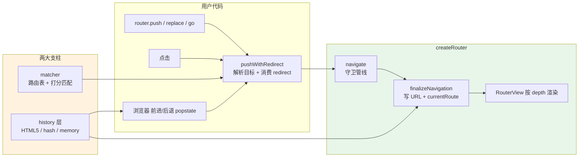

# mini-vue-router 原理文档

> 读完这份文档,你可以:① 理解 Vue Router 4 的核心原理;② 读得懂本仓库的每一行代码;③ 顺着对照表继续啃官方源码。

## 架构总览



一句话原理:**导航 = 把「目标」解析成 RouteLocation(matcher)→ 跑一串守卫(管线)→ 写浏览器地址(history)→ 更新响应式的 currentRoute → RouterView 重新渲染。**

## 模块职责

| 模块 | 文件 | 职责 | 对应官方 |
|---|---|---|---|
| 入口 | `src/index.ts` | 公共 API 汇总 | `packages/router/src/index.ts` |
| 路由器 | `src/router.ts` | 导航管线、守卫、install | `packages/router/src/router.ts` |
| 匹配器 | `src/matcher/index.ts` | 路由表增删查、resolve | `packages/router/src/matcher/index.ts` |
| 路径编译 | `src/matcher/pathTokenizer.ts` | 路径字符串 → 正则 + 打分 | `matcher/pathTokenizer.ts` + `pathParserRanker.ts` |
| history | `src/history/*` | 三种 URL 模式 | `packages/router/src/history/*` |
| 组件 | `src/components/*` | RouterLink / RouterView | `packages/router/src/RouterLink.ts` 等 |
| 滚动 | `src/scrollBehavior.ts` | 滚动位置保存/恢复 | `packages/router/src/scrollBehavior.ts` |
| 类型/错误/工具 | `types.ts` `errors.ts` `utils.ts` | 公开类型、导航失败、工具函数 | 同名官方文件 |

## 推荐阅读顺序

```
docs/README.md               ← 你在这里
  ↓
docs/01-path-matching.md     路由是怎么匹配的(最硬核,先啃)
  ↓
docs/02-history.md           URL 是怎么被读写的(两种模式)
  ↓
docs/03-navigation-pipeline.md  一次 push 的完整生命周期(核心中的核心)
  ↓
docs/04-navigation-guards.md 守卫的顺序从哪来(与 03 配套)
  ↓
docs/05-components.md        RouterView / RouterLink 原理
  ↓
docs/06-dynamic-and-advanced.md  动态路由 / 懒加载 / 滚动 / 性能
  ↓
docs/07-source-map.md        mini ↔ 官方对照表 + 简化点 + 继续啃官方的路线
```

每章标题都标注了「对应官方文件」,读 mini 的代码时随时可以打开官方源码对照。

## 快速自测

- `npm test` — 142 个单测,其中 `tests/parity.spec.ts` 是**与官方 vue-router 的行为对拍**(同一张路由表、同一批 URL,两边结果必须一致)
- `npm run dev` — 可运行 demo(history / hash 两种模式,含守卫日志面板、动态路由、懒加载、滚动演示)